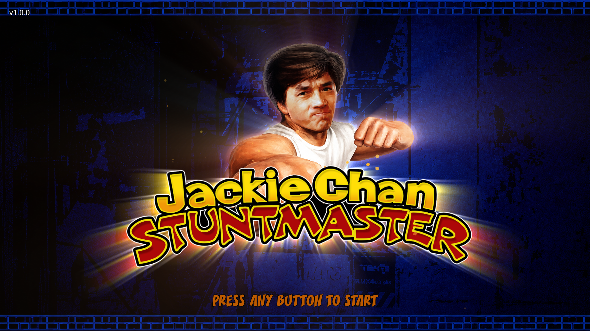
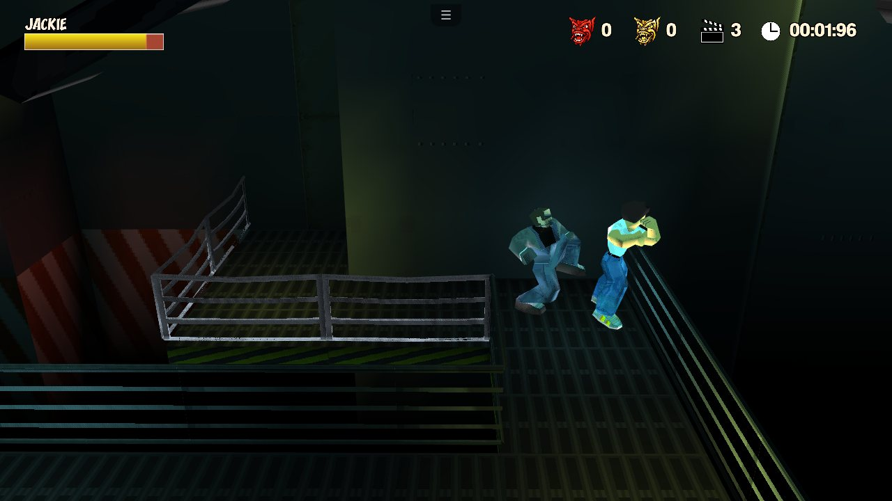
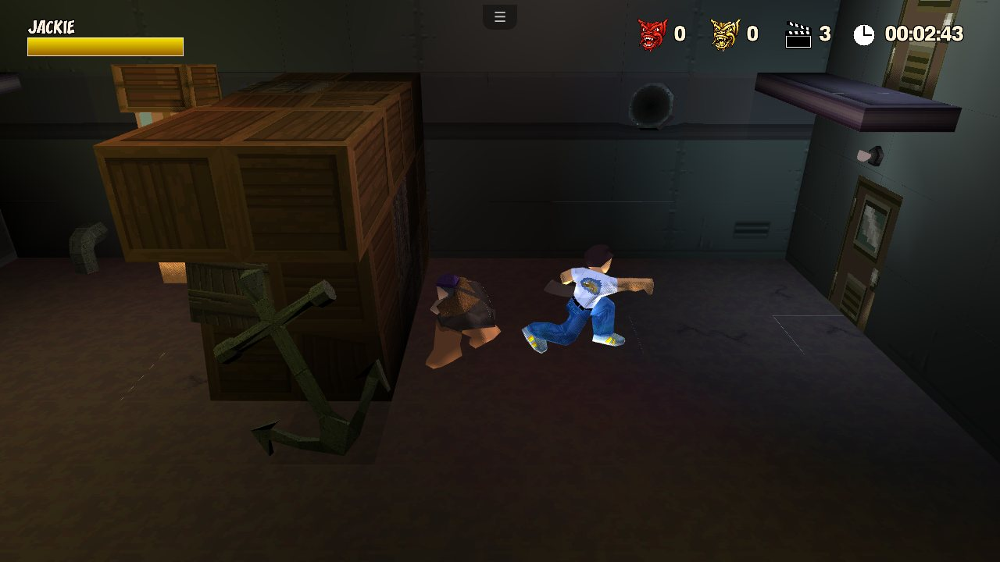
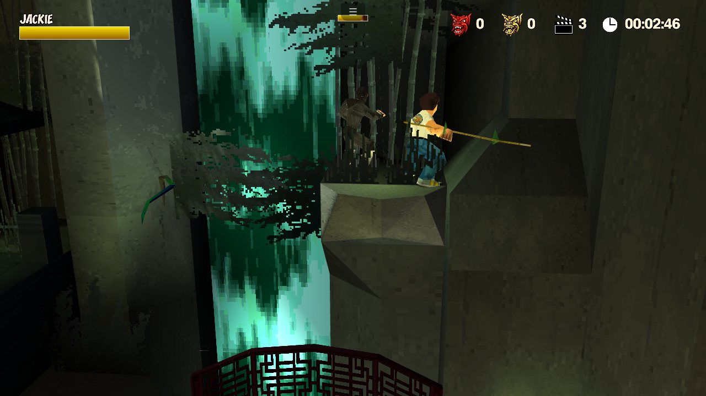
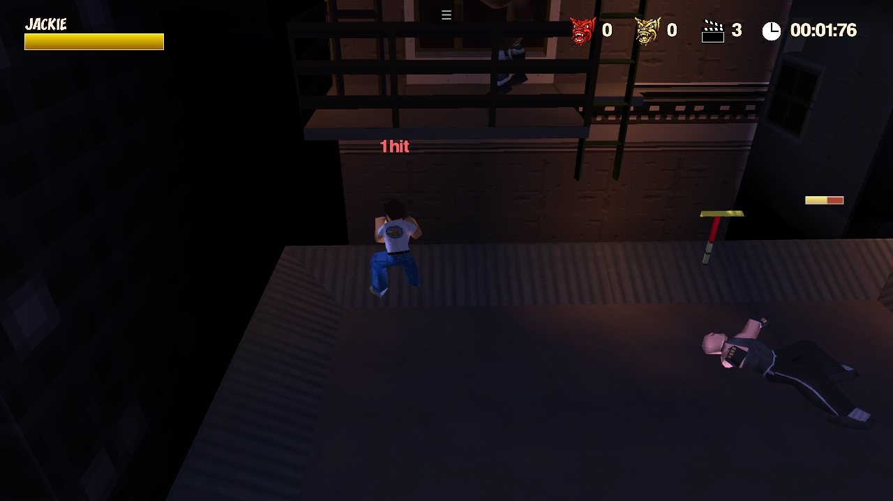
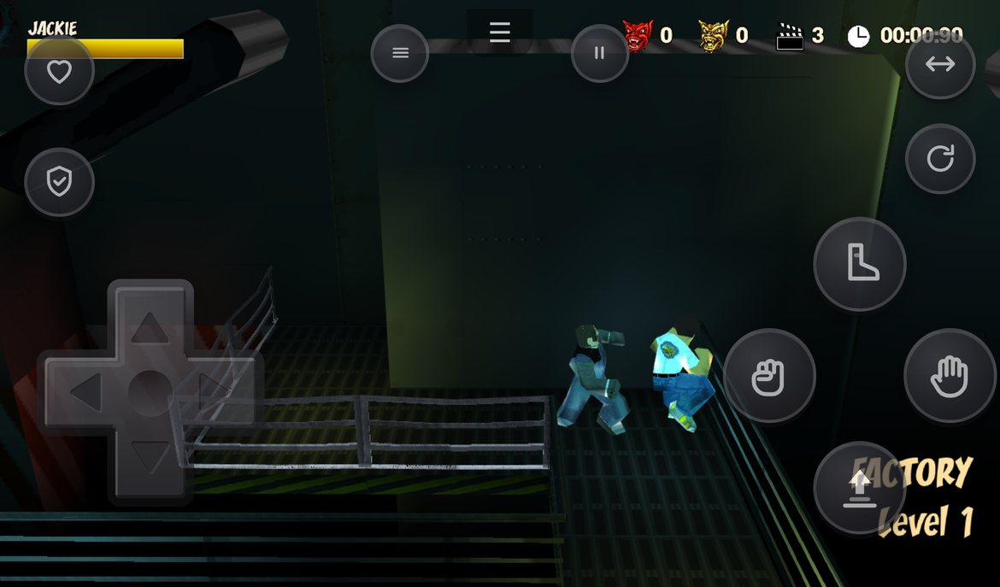
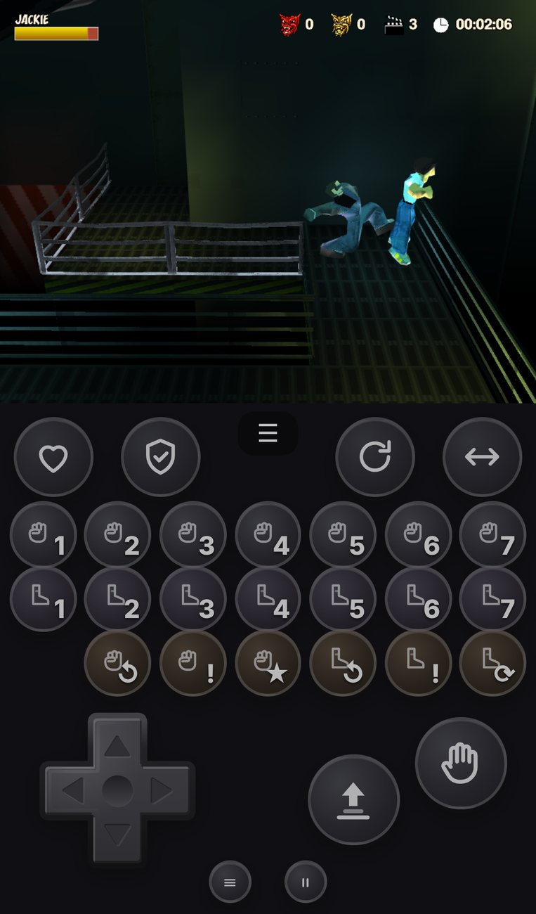
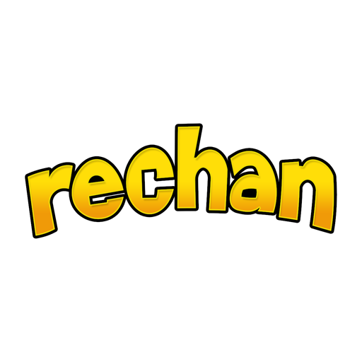
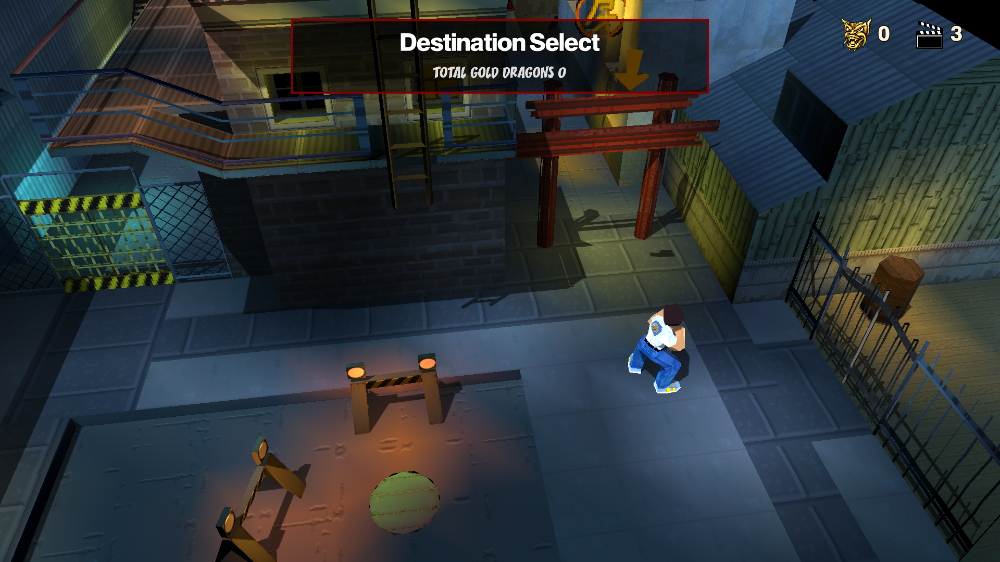
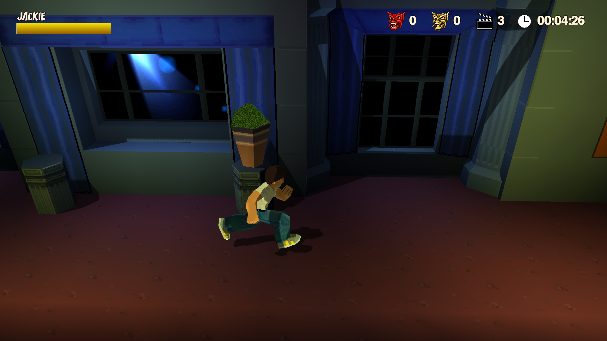

<h1 align="center">ReChan Web</h1>

<p align="center">
  
</p>

<p align="center">
  <b>Jackie Chan Stuntmaster en tu navegador</b>: PC, Mac, iPhone, iPad y Android, sin instalar nada.<br>
  Port web de <a href="https://github.com/SilverwireGames/ReChan">ReChan</a>, por Bardock.
</p>


<p align="center">
  <a href="https://gabom88.github.io/ReChan/"><b>▶ Jugar ahora</b></a> ·
  <a href="GUIA-PAQUETE-ZIP.md">Guía del paquete ZIP</a> ·
  <a href="#controles">Controles</a> ·
  <a href="#créditos">Créditos</a>
</p>

<p align="center">
  
  
  
  
</p>
<p align="center">
  
  
</p>

> [!NOTE]
> Este repositorio es un fork de **[SilverwireGames/ReChan](https://github.com/SilverwireGames/ReChan)**. La ingeniería inversa y la reimplementación del juego son obra de su creador, **_AG (SilverwireGames)**. Este fork añade la versión para navegador. Necesitas tu **propia copia** del juego: aquí no se distribuye ningún dato del original.

## Qué es

Es el mismo código C++ de ReChan compilado a WebAssembly, que se ejecuta con WebGL2. **No es un emulador de PlayStation**: el juego está reimplementado, así que se ve más nítido, va más fluido y admite mejoras como sombras dinámicas y antialiasing.

- 🎮 **Juega donde quieras:** en el navegador, a pantalla completa o instalado como app (PWA), también sin conexión.
- 💿 **Tu disco, una sola vez:** el juego lee tu `.bin` en tu propio dispositivo, sin subirlo a ningún sitio. Guarda solo lo que necesita y después ya no hace falta la imagen.
- 📱 **Mando táctil configurable** en horizontal o en vertical, además de teclado, ratón y mandos (Xbox, PlayStation, MFi…).
- 🥋 **Ataques directos:** un botón para cada golpe de Jackie, para no tener que encadenar combos.
- 🎵 **Modo experimental ZIP:** audio y vídeo en formatos modernos (AAC y H.264). Suenan sin cortes y el paquete ocupa menos de 100 MB.
- 🔄 **Actualizaciones con un toque:** la app avisa cuando hay una versión nueva.

## Cómo empezar

1. Abre **https://gabom88.github.io/ReChan/** en un navegador moderno: Safari 15+, Chrome, Edge o Firefox.
2. Pulsa **Elegir imagen del disco** y selecciona tu `.bin` o `.iso` de *Jackie Chan Stuntmaster* **NTSC-U (SLUS-00684)**.
3. Cuando termine la extracción, pulsa **Jugar**. Las siguientes veces el juego arranca directamente.

**iPhone / iPad:** en Safari toca **Compartir → Añadir a pantalla de inicio**. Así se juega a pantalla completa y el sistema no borra tus datos. Safari borra el almacenamiento de las webs que no se visitan en 7 días, pero no el de las apps de la pantalla de inicio.

### Modo experimental: paquete ZIP (opcional)

En lugar del `.bin` puedes cargar un **paquete ZIP** creado en tu ordenador. La música, las voces y los vídeos van en formatos que el navegador reproduce de forma nativa, así que el audio no se entrecorta, los vídeos se ven mejor y el paquete ocupa menos de 100 MB.

👉 **[Guía paso a paso para crear tu paquete ZIP](GUIA-PAQUETE-ZIP.md)**. El conversor ([rechan-conversor.zip](https://gabom88.github.io/ReChan/rechan-conversor.zip)) funciona con doble clic en Mac y Windows.

El modo con `.bin` sigue siendo el **estable**. La pantalla de inicio muestra el modo activo. Para cambiar de modo, ve a **Opciones → Borrar assets extraídos** (tus partidas se conservan) y carga el otro archivo. El ZIP contiene el juego: es solo para tu uso personal.

## Controles

| Acción | Teclado | Mando | Táctil |
|---|---|---|---|
| Moverse | W A S D | Stick izquierdo / cruceta | Cruceta o joystick |
| Saltar | Espacio | ✕ / A | ⤒ |
| Puñetazo | J / clic izquierdo | □ / X | ✊ |
| Patada | K / clic derecho | △ / Y | 🦶 |
| Agarrar | E / clic central | ○ / B | ✋ |
| Contraataque | C | L1 | 🛡 |
| Rodar (maroma) | Ctrl izquierdo | R1 | ⟳ |
| Desplazamiento lateral | Shift izquierdo | R2 | ↔ |
| Estado | Tab | L2 | ♥ |
| Menú | Esc | Start | ⏸ |

El juego permite reasignar las teclas desde sus opciones. El botón **☰** abre las opciones de la versión web.

### Mando táctil

En **Configurar mando táctil**, desde la pantalla de inicio o desde **☰** durante la partida, puedes:

- **arrastrar** cualquier control para moverlo, y **tocarlo** para cambiar su tamaño u ocultarlo;
- ajustar la **opacidad**, elegir **cruceta o joystick** y activar la **vibración** (donde el navegador la admite);
- jugar **en horizontal o en vertical**. En vertical, el juego ocupa la parte de arriba y los controles quedan debajo, como en una consola portátil. Cada orientación guarda su propia distribución. La cruceta es la de [GBoy-JS](https://github.com/gabom88/gemuboy-js).

En modo **Automático**, el mando táctil se oculta al usar un teclado o un mando físico y vuelve a aparecer al tocar la pantalla.

### Ataques directos

Activa **Golpes: directos** en la configuración del mando táctil. Los botones de puñetazo y patada se sustituyen por un botón para cada golpe de Jackie. Cada golpe sale con su daño, su reacción en el enemigo y sus combos de siempre.

| Fila | Botones |
|---|---|
| Puñetazos | 1 – 7 |
| Patadas | 1 – 7 |
| Especiales (dorados) | puñetazo de espalda ↺ · puñetazo fuerte ! · golpe especial ★ · patada de espalda ↺ · patada fuerte ! · **maroma + patada ⟳** · **patada de maroma ↯** |

- **Maroma + patada (⟳)** hace la maroma y, a mitad, la patada, igual que si pulsaras R1 y enseguida patada.
- **Patada de maroma (↯)** lanza solo esa patada baja, sin la maroma.
- Los movimientos que dependen de la situación salen como en el original aunque uses botones directos:
  - golpes, patada y lanzamiento con un enemigo agarrado;
  - ataque en salto;
  - patada contra la pared;
  - ataque al levantarte del suelo;
  - contraataques.
- **Con teclado:** en **☰ → Opciones → Teclas de golpes** puedes asignar una tecla a cada golpe. Por defecto no hay ninguna asignada; solo funcionan las teclas propias del juego.

### Gráficos, mods y más

- **Gráficos** (Pausa → Opciones): resolución, **antialiasing** y **sombras dinámicas**, como en PC. En iPhone se recomiendan sombras «Baja» o «Media». En **☰ → Opciones** también puedes bajar la resolución de render si tu dispositivo va justo.
- **Mods** (Pausa → Opciones → Mods): **saltos infinitos**, **atravesar paredes** y **cámara que sigue a Jackie**. Como los trucos, se desactivan al cargar una partida.
- **Volver al mapa:** **☰ → Opciones → Volver al mapa** sale del nivel y vuelve al mapa de selección de niveles.
- **Actualizaciones:** cuando hay una versión nueva, la pantalla de inicio y el menú **☰** muestran «Nueva versión disponible» con el botón **Actualizar**, y el botón ☰ lleva un punto verde. Al pie de la pantalla de inicio ves tu versión y el enlace **Buscar actualizaciones**.
- **¿Algo falla?** Pulsa **F8** o **☰ → Copiar diagnóstico** y pega el texto en un [issue](https://github.com/gabom88/ReChan/issues).

## Créditos

- **ReChan:** creado por **_AG**, de [SilverwireGames/ReChan](https://github.com/SilverwireGames/ReChan). Suyos son la ingeniería inversa, la reimplementación del juego, el motor (libp3d), el port a Switch (cuyo backend GLES hace posible esta versión) y el extractor de disco. Licencia MIT.
- **Port web:** Bardock ([gabom88](https://github.com/gabom88)).
- **Bibliotecas:** [Emscripten](https://emscripten.org/), [miniaudio](https://miniaud.io/), [Dear ImGui](https://github.com/ocornut/imgui), [cgltf](https://github.com/jkuhlmann/cgltf), [stb](https://github.com/nothings/stb) y [ffmpeg](https://ffmpeg.org/) (en el conversor).
- *Jackie Chan Stuntmaster* y todas sus marcas, personajes y assets pertenecen a sus respectivos dueños. Este proyecto no distribuye ningún dato del juego original.

---

# Parte técnica

<details>
<summary><b>Sobre este repositorio</b></summary>

El port web se compila a partir del mismo código que la versión de PC: `src/` (el juego), `vendor/libp3d` (el motor) y `res/pc` (textos, fuentes y texturas propios de ReChan). Las partes de Windows, Linux y Switch se mantienen para seguir recibiendo las mejoras del proyecto original y para comparar la web con la versión nativa en las pruebas. Lo propio del port está en `web/`, `tools/media_pack/` y los cambios marcados con `RC_PLATFORM_WEB`.

</details>

### Cómo funciona (sin depender del BIN)

```text
 .bin / .iso (en tu dispositivo)
        │  File.slice(): se lee por partes, nunca se sube ni se carga entero en memoria
        ▼
 web/shell/js/extractor.js ── verifica SYSTEM.CNF (SLUS-00684) y aplica la lista blanca
        │
        ▼
 IndexedDB "rechan-assets": un Blob por archivo ("xc/lev01.lcf", …)
        │  lectura perezosa por rangos (EM_ASYNC_JS + Asyncify)
        ▼
 p3d::io (vendor/libp3d/p3d/fileio.cpp) ── el motor abre y lee los archivos como siempre
```

- **Extracción:** es la misma que hace el extractor del juego en PC. Las carpetas son `fe`, `rchars`, `rtarget`, `scr`, `sound`, `tim` y `xc`, más seis archivos de la raíz. El resultado es idéntico byte a byte al de `tools/extract_assets/extract_psx_bin.py`.
- **Memoria:** el navegador guarda en disco los Blobs de IndexedDB, así que los assets no ocupan RAM. Los archivos pequeños se leen enteros al abrirlos; los grandes, con una ventana de lectura anticipada de 1 MB. Esto es clave para que no se cierre en un iPhone.
- **Asyncify:** el motor se pausa en cada lectura asíncrona y continúa cuando llegan los datos, sin hilos y sin reescribir el código del juego.
- **Partidas y opciones:** `userfiles/` se guarda en IndexedDB mediante IDBFS.
- **Modo ZIP:** `web/shell/js/zippack.js` importa el paquete y `media.js` reproduce el AAC y el H.264 con el navegador. Los hooks del motor están en `src/pc/webmedia.cpp`.
- **Sin hilos:** no necesita `SharedArrayBuffer` ni COOP/COEP, así que funciona en cualquier hosting estático y en Safari de iOS.
- **Render:** usa el backend OpenGL ES 3.0 de ReChan (GLES 3.0 equivale a WebGL2), con MSAA y sombras en cascada activados para la web.

### Compilar

Requisitos: [Emscripten](https://emscripten.org/docs/getting_started/downloads.html) (probado con la 7.0.0), `make` y Python 3.

```bash
git clone https://github.com/emscripten-core/emsdk.git
```

```bash
cd emsdk && ./emsdk install 7.0.0 && ./emsdk activate 7.0.0 && source ./emsdk_env.sh && cd ..
```

```bash
make -C web -j"$(nproc)"
```

El resultado queda en `web/dist/`, con el `version.json` y el `rechan-conversor.zip`. Para probarlo en local:

```bash
python3 -m http.server -d web/dist 8080
```

Abre `http://localhost:8080`. Usa `localhost` o HTTPS, porque el service worker no funciona en otros orígenes HTTP. `make -C web DEBUG=1` genera un build con símbolos.

### Publicación en GitHub Pages

El workflow [`.github/workflows/web.yml`](.github/workflows/web.yml) compila y publica en cada push a `main`. Solo hay que activarlo una vez en **Settings → Pages → Build and deployment → Source: «GitHub Actions»**. También se puede lanzar a mano desde **Actions → Web (GitHub Pages) → Run workflow**.

### Cambios respecto a ReChan

| Archivo | Cambio |
|---|---|
| `web/` | Makefile de Emscripten, glue (`rechan_web.pre.js`) y la página: lanzador, extractor, importador ZIP, almacén IndexedDB, entrada, mando táctil, actualizaciones, PWA y service worker. |
| `tools/media_pack/` | Conversor del paquete ZIP (`make_rechan_pack.py`, decodificador ADPCM `psx_audio.py`, lanzadores y `build_tool_zip.py`). |
| `vendor/libp3d/pddi/gles/glesweb.{h,cpp}` | Ventana WebGL2 y mando para la web, sobre el backend GLES 3.0. |
| `vendor/libp3d/pddi/gles/glesrender.{h,cpp}` | Partes exclusivas de Switch tras `#if`. En la web, MSAA, cascadas de sombras e id de caster R32UI. |
| `vendor/libp3d/p3d/fileio.{h,cpp}` | Lectura perezosa de assets desde IndexedDB y guardado persistente de `userfiles/`. |
| `src/pc/webmedia.*`, `src/pc/webdiag.*`, `src/pc/autotest.*`, `src/pc/animwatch.*` | Audio y vídeo del modo ZIP, puente con la página, modo de prueba y detector de animaciones atascadas. |
| `src/ai/*`, `src/gen/*`, `src/extra/*` | Correcciones (personajes congelados, callbacks de animación en wasm), ataques directos, mods, «Volver al mapa». |

Los cambios específicos de la web están protegidos con `RC_PLATFORM_WEB` / `__EMSCRIPTEN__`, así que los builds de Windows, Linux y Switch no cambian.

### Notas y limitaciones

- Solo se admite la versión **NTSC-U (SLUS-00684)**, como en PC.
- **Sombras en la web:** «Muy alta» usa mapas de 4096 px en vez de 8192, porque los de 8192 necesitarían unos 1,5 GB de memoria de vídeo.
- **MSAA:** se ajusta al máximo que admite el navegador, normalmente 4×.
- **Audio:** usa `ScriptProcessorNode` (Web Audio sin hilos). Funciona en todos los navegadores, aunque está marcado como obsoleto.
- **Compilación:** se usa `-fno-strict-aliasing -fwrapv` para igualar la semántica de MSVC. Sin esas opciones, Clang `-O3` puede romper el código reimplementado de PSX, que hace mucho *type punning*.
- **Capturas:** las de este README son de la versión web, tomadas en Chromium con sombras y antialiasing activados.

### Modo de prueba

En **☰ → Opciones → Modo de prueba** eliges un nivel (o todos) y la duración. El juego carga el nivel, pelea solo, recorre todos los enemigos y al final indica si algún personaje se quedó atascado.

- **Por URL:** `?autotest=NIVEL&minutes=N`. Con `fight=0` y `tour=0` se desactivan el combate y el recorrido.
- **En el ejecutable:** `--autotest N --fight --tour 450`. Sirve para comparar la versión web con la nativa.

---

# README original de ReChan

<table align="center">
<tr>
<td valign="middle">

# ReChan
**ReChan** is a reverse engineering project focused on reimplementing the game:\
**Jackie Chan Stuntmaster**.

### To use this project:
* You **must own a legal copy** of *Jackie Chan Stuntmaster* (SLUS-00684).
* You must provide your own game disc image.
* All rights to the original game, assets and intellectual property belong to their respective owners.

<br>


</td>

<td align="center" valign="middle" width="256">

</td>
</tr>
</table>

## About
* Target version: **SLUS-00684**
* Development started: **October 2025**

The project focuses on:
* reconstructing game logic and systems
* rebuilding data structures and formats
* matching original runtime behavior

A large part of the work has been dedicated to documentation and understanding
the original codebase before reimplementation.

## Enhancements
Beyond reconstruction, the project also introduces improvements over the original PlayStation version:
- keyboard and mouse support  
- HOR+ widescreen support  
- higher resolution rendering  
- PC-specific settings and enhancements  
- general quality-of-life improvements  

## Screenshots
<p align="center">
  
  
  
</p>

## Getting Started

Game data is **not included**. Place a legally obtained NTSC-U game image from
your own copy (`.bin` or `.iso`) in a `discimage` folder beside the executable:

```text
rechan/
|-- rechan.exe       # Windows (use "rechan" on Linux)
`-- discimage/
    `-- game.bin     # or game.iso, file name doesn't matter
```

Keep only one disc image in `discimage`. On first launch, ReChan verifies the
disc version and uses its built-in extractor to prepare the required assets.
No separate extraction utility is needed.
Once assets are extracted the disc image folder can be deleted.

ReChan currently supports 64-bit x86 (`x86_64`) Windows and Linux. To compile
it yourself, see the [build guide](docs/BUILDING.md).

## Legal and Asset Notice

ReChan is an unofficial, free, non-commercial reimplementation project for
*Jackie Chan Stuntmaster*. It is not affiliated with, endorsed by, sponsored
by, or approved by any original developer, publisher, license holder, or
rights holder.

The release package may include support files created specifically for ReChan
by the project author, including new text files, fonts, and textures. These are
newly authored ReChan files, not files from the PlayStation game. They do not
contain or redistribute content extracted or copied from the original game.

For the avoidance of doubt, **no original game assets, disc images, ROMs,
original game executables, videos, music, voice clips, textures, models,
levels, or other copyrighted PlayStation game data are included or distributed
with ReChan.**
The disc image placed in `discimage` is supplied by the user from their own
legally obtained copy. Its required assets are extracted locally on that
user's computer and are not part of the ReChan distribution.

*Jackie Chan Stuntmaster* and all related trademarks, copyrights, characters,
names, logos, assets, and game data remain the property of their respective
rights holders. Third-party libraries or assets included with ReChan remain
subject to their respective licenses.

## FAQ
**Is this a PS1 emulator?**  
No. ReChan is a reimplementation, the game logic is rewritten in C++ for PC and does not emulate PS1 hardware.

**Will this work with PAL versions?**
Currently only the NTSC-U version (**SLUS-00684**) is targeted. The PAL version is not supported and may differ in data layouts.

**Will this ever support original PS1 hardware?**  
No. That is not a goal of this project.

**Can I contribute?**  
Yes. Documentation, data formats, and behavior analysis are all welcome. See
the [build guide](docs/BUILDING.md) to get started.

## Crash reports

Fatal crashes create `minidumps/rechan-crash-<process-id>.txt` and ask the user
to open a GitHub issue. Windows also creates a matching `.dmp` minidump in that
folder. Debug reports append `rechan.log`; Release builds compile out logging
entirely. Reports are stored locally and are never uploaded automatically.

Maintainers can verify the packaged crash handler with
`--test-crash-reporter`. Set `RECHAN_CRASH_REPORTER_NO_DIALOG=1` when running
that check in automation.

## License
MIT License.

Applies only to this codebase.
Does not apply to the original game or its assets.
