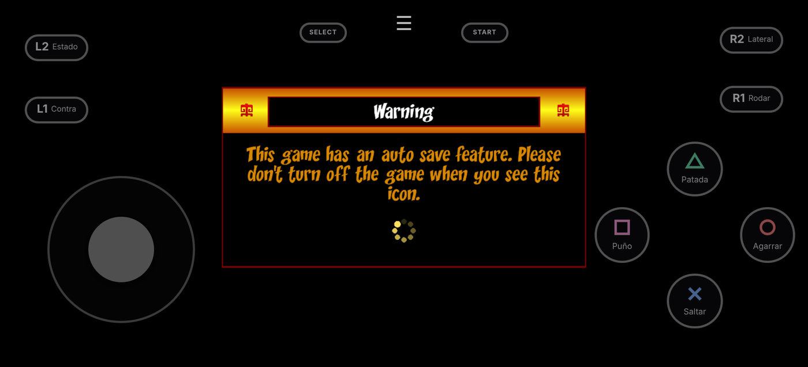
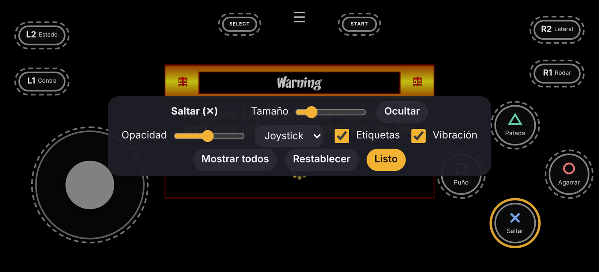
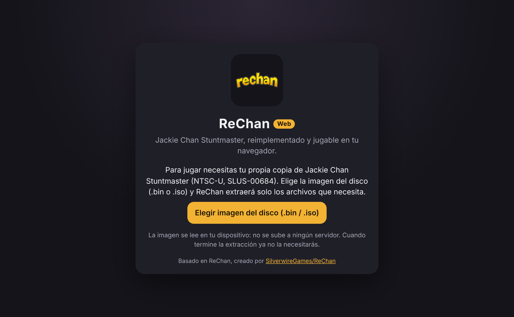

> [!NOTE]
> **Este repositorio es un fork de [SilverwireGames/ReChan](https://github.com/SilverwireGames/ReChan)** con un **port nativo para navegador** (WebAssembly + WebGL2) jugable desde GitHub Pages, Safari en iPhone y como PWA.
> Todo el trabajo de ingeniería inversa y la reimplementación del juego son obra del creador original de ReChan, **_AG ([SilverwireGames](https://github.com/SilverwireGames))**. Este fork solo añade la capa web. Más abajo está el README original.

# ReChan Web — port para navegador

**Jugar:** https://gabom88.github.io/ReChan/ (una vez activado GitHub Pages, ver [Publicación](#publicación-en-github-pages))

<p align="center">
  
  
</p>
<p align="center">
  
</p>

<sub>Capturas tomadas con una imagen de disco de prueba (sin los assets reales del juego), por eso el motor se queda en su primera pantalla. Con el disco real se ve el juego completo, como en las capturas del README original.</sub>

## Qué es

Es el **mismo código C++ de ReChan** compilado a WebAssembly con Emscripten. **No es un emulador de PlayStation** ni una reescritura en JavaScript. El renderizado usa el backend **OpenGL ES 3.0** que ReChan ya tenía para Switch (GLES 3.0 equivale a WebGL2), así que los shaders y la lógica del juego son los mismos que en PC.

- **Sin hilos (single-threaded):** no necesita `SharedArrayBuffer` ni las cabeceras COOP/COEP, así que funciona en cualquier hosting estático (GitHub Pages) y en Safari de iOS.
- **Sin depender del BIN:** el disco se lee **una sola vez, en tu dispositivo**, y se guardan solo los assets necesarios. Después la imagen ya no hace falta.
- **Mando táctil configurable**, además de teclado, ratón y mandos físicos (Gamepad API: Xbox, PlayStation, MFi…).
- **PWA instalable:** pantalla completa, orientación horizontal, icono propio y funcionamiento sin conexión una vez cargado.

## Cómo jugar

1. Abre la página en un navegador con WebGL2 (Safari 15+ en iPhone/iPad/Mac, Chrome, Edge o Firefox).
2. Pulsa **Elegir imagen del disco** y selecciona tu `.bin` o `.iso` de *Jackie Chan Stuntmaster* **NTSC-U (SLUS-00684)**, sacado de tu propia copia.
3. ReChan verifica el serial del disco y extrae solo lo que necesita (carpetas `fe`, `rchars`, `rtarget`, `scr`, `sound`, `tim`, `xc` y seis archivos de la raíz). La extracción es la misma que hace el extractor del juego en PC, y su resultado es byte a byte igual al de `tools/extract_assets/extract_psx_bin.py`.
4. Pulsa **Jugar**. Las siguientes veces el juego arranca directamente, sin pedir el disco.

### Dos modos: BIN (estable) y ZIP (experimental)

- **Modo BIN · estable:** cargas el `.bin` o `.iso` y el juego usa el audio y el vídeo originales de PlayStation. Es el modo de siempre.
- **Modo ZIP · experimental:** cargas un ZIP preparado en tu PC con [`tools/media_pack`](tools/media_pack/README.md). La música y las voces van en AAC y los vídeos en H.264 (MP4), que el navegador decodifica por hardware. El ZIP ocupa mucho menos que el BIN. Lo generas en tu PC así:

  ```bash
  python3 tools/media_pack/make_rechan_pack.py "Jackie Chan Stuntmaster (USA).bin"
  ```

  En Windows también puedes arrastrar el `.bin` sobre `tools/media_pack/make_rechan_pack.bat`. Necesitas Python 3.9+ y ffmpeg. El ZIP es solo para uso personal: no lo compartas.

El panel **Listo** muestra el modo activo. Para cambiar de modo, pulsa **Borrar assets extraídos** (tus partidas se conservan) y carga el otro archivo. Si el modo ZIP no encuentra un archivo de audio o vídeo convertido, usa el original del juego.

**Actualizaciones:** cuando se publica una versión nueva, la pantalla de inicio y el menú ☰ muestran «Nueva versión disponible» con el botón **Actualizar**, y el botón ☰ lleva un punto verde. El juego no cambia de versión a mitad de una partida: la nueva se descarga en segundo plano y se activa al pulsar Actualizar, que recarga la página (las partidas guardadas se conservan). Al pie de la pantalla de inicio y de Opciones se ve la versión actual y el enlace **Buscar actualizaciones**.

**En iPhone/iPad:** en Safari toca **Compartir → Añadir a pantalla de inicio**. Así el juego se abre a pantalla completa (Safari no permite pantalla completa en páginas normales del iPhone) y el sistema no borra los datos guardados. Safari puede borrar el almacenamiento de las webs que no se visitan en 7 días, pero no el de las apps de la pantalla de inicio.

### Controles

| Acción | Teclado | Mando | Táctil |
|---|---|---|---|
| Moverse | W A S D | Stick izquierdo / cruceta | Joystick o cruceta (configurable) |
| Saltar | Espacio | ✕ / A | ✕ |
| Puñetazo | J / clic izquierdo | □ / X | □ |
| Patada | K / clic derecho | △ / Y | △ |
| Agarrar | E / clic central | ○ / B | ○ |
| Contraataque | C | L1 | L1 |
| Rodar | Ctrl izquierdo | R1 | R1 |
| Desplazamiento lateral | Shift izquierdo | R2 | R2 |
| Estado | Tab | L2 | L2 |
| Menú | Esc | Start | START |

El juego permite reasignar las teclas desde sus propias opciones. El botón **☰** de arriba abre las opciones de la versión web.

### Mods (Pausa → Opciones → Mods)

- **Saltos infinitos:** Jackie vuelve a saltar en el aire cada vez que pulsas saltar.
- **Atravesar paredes:** Jackie ignora las paredes. El suelo, las cajas y los obstáculos se siguen respetando, así que si atraviesas una pared exterior del nivel y detrás no hay suelo, caerás.
- **Cámara sigue a Jackie:** la cámara mantiene el ángulo y la distancia que el nivel define en cada zona, pero ya no limita cuánto puede desplazarse, así que Jackie queda siempre centrado.
- **Mods instalados:** la lista de mods de archivos de siempre (carpeta `~mods`).

Dentro de un nivel, **☰ → Opciones → Volver al mapa** (el menú de la página web, el mismo del Modo de prueba) sale del nivel tras pedir confirmación y regresa al mapa donde se eligen los niveles. También está en **Pausa → Opciones → Volver al mapa**, y equivale a «Salir del nivel» del menú de pausa.

Los mods, igual que los trucos, se desactivan al cargar una partida. El truco **Rumbo al cielo** (Opciones → Trucos) hace que los enemigos derrotados asciendan al cielo; si está desactivado, simplemente desaparecen como en el original. El diagnóstico de **F8** indica qué trucos y mods están activos.

### Configurar el mando táctil

Se puede jugar **en horizontal o en vertical**. En vertical, el juego ocupa la franja superior (4:3) y los controles quedan debajo, como en una consola portátil; cada orientación guarda su propia distribución. La cruceta es la misma de [GBoy-JS](https://github.com/gabom88/gemuboy-js), y los botones de acción muestran un dibujo de lo que hacen (puño, pie, salto, mano, escudo, etc.).

Desde el lanzador (**Configurar mando táctil**) o durante la partida (**☰ → Configurar mando táctil**):

- **Arrastra** cualquier control para moverlo.
- **Tócalo** para seleccionarlo y cambiar su **tamaño** u **ocultarlo**.
- Ajusta la **opacidad**, elige **cruceta o joystick** y activa o desactiva la **vibración** (la vibración solo funciona en navegadores que la soportan; Safari de iOS no).
- **Mostrar todos** vuelve a mostrar los controles ocultos y **Restablecer** recupera la distribución por defecto.
- **Golpes: directos (1–7 + especiales):** modo de control extra que sustituye los botones de puño y patada por **7 puñetazos y 7 patadas numerados, más 5 especiales**. Cada botón lanza directamente ese golpe del árbol de combos de Jackie (con su daño, su reacción en el enemigo y sus continuaciones normales), en lugar de tener que encadenarlo. Solo se aplica a la pelea sin arma.

  | Botón | 1 | 2 | 3 | 4 | 5 | 6 | 7 |
  |---|---|---|---|---|---|---|---|
  | Puñetazo (animación) | 57 | 58 | 59 | 60 | 61 | 62 | 26 |
  | Patada (animación) | 53 | 54 | 55 | 56 | 44 | 42 | 48 |

  **Con teclado:** en **☰ → Opciones → Teclas de golpes** se asigna una tecla a cada uno de los 19 golpes (pulsa el botón y luego la tecla; Esc cancela, Retroceso borra). Por defecto: puñetazos `1`–`7`, patadas `Z X V B N M ,` y especiales `8 9 0 . /`. Funcionan siempre, sin importar el modo del mando táctil. Mantener la tecla o el dedo no convierte el golpe en otro: solo se envía un toque breve.

  Especiales (fila dorada): puñetazo de espalda ↺ (64), puñetazo fuerte ! (23), golpe especial ★ (63), patada de espalda ↺ (65) y patada fuerte ! (67). El golpe especial es un agarre: necesita un enemigo al alcance.

La configuración se guarda en el navegador. En modo **Automático**, el mando táctil se oculta al usar un teclado o mando físico y vuelve a aparecer al tocar la pantalla. También puedes fijarlo en **Siempre** o **Nunca**, y bajar la **resolución de render** si el dispositivo va justo.

## Cómo funciona (sin depender del BIN)

```text
 .bin / .iso (en tu dispositivo)
        │  File.slice(): se lee por partes, nunca se sube ni se carga entero en memoria
        ▼
 web/shell/js/extractor.js ── verifica SYSTEM.CNF (SLUS-00684) y aplica la lista blanca
        │
        ▼
 IndexedDB "rechan-assets": un Blob por archivo ("xc/lev01.lcf", …)
        │  lectura perezosa por rangos (EM_ASYNC_JS + Asyncify)
        ▼
 p3d::io (vendor/libp3d/p3d/fileio.cpp) ── el motor abre y lee los archivos como siempre
```

- Los Blobs leídos de IndexedDB los guarda el navegador en disco, así que **los assets no ocupan RAM**. El motor pide solo los bytes que necesita: los archivos pequeños se leen enteros al abrirlos y los grandes (vídeos, bancos de sonido) mediante una ventana de lectura anticipada de 1 MB. Esto es clave para que no se cierre en un iPhone.
- Las lecturas del navegador son asíncronas. Con **Asyncify**, el motor se pausa en la lectura y continúa cuando llegan los datos, sin hilos y sin reescribir el código del juego.
- Las partidas y opciones (`userfiles/`) se guardan en IndexedDB mediante IDBFS.
- Los textos, fuentes y texturas propios de ReChan (`res/pc`) van empaquetados en `rechan.data`. No incluyen nada del juego original.

## Compilar

Requisitos: [Emscripten](https://emscripten.org/docs/getting_started/downloads.html) (probado con la versión 7.0.0), `make` y Python 3.

```bash
git clone https://github.com/emscripten-core/emsdk.git
```

```bash
cd emsdk && ./emsdk install 7.0.0 && ./emsdk activate 7.0.0 && source ./emsdk_env.sh && cd ..
```

```bash
make -C web -j"$(nproc)"
```

El resultado queda en `web/dist/`: son archivos estáticos listos para publicar. Para probar en local:

```bash
python3 -m http.server -d web/dist 8080
```

Después abre `http://localhost:8080`. Usa `localhost` o HTTPS: el service worker no funciona en otros orígenes HTTP. `make -C web DEBUG=1` genera un build con símbolos.

## Publicación en GitHub Pages

El workflow [`.github/workflows/web.yml`](.github/workflows/web.yml) compila el port y lo publica en cada push a `main`. Solo hay que activarlo una vez:

**Settings → Pages → Build and deployment → Source: «GitHub Actions»**

También se puede lanzar a mano desde la pestaña **Actions** (*Web (GitHub Pages)* → *Run workflow*).

## Cambios respecto a ReChan

| Archivo | Cambio |
|---|---|
| `web/` | Makefile de Emscripten, glue (`rechan_web.pre.js`) y la página: lanzador, extractor, almacén IndexedDB, entrada, mando táctil, PWA y service worker. |
| `vendor/libp3d/pddi/gles/glesweb.{h,cpp}` | Ventana WebGL2 y mando para la web, sobre el backend GLES 3.0 existente. |
| `vendor/libp3d/pddi/gles/glesrender.{h,cpp}` | Las partes exclusivas de Switch (EGL/NWindow, HID) quedan tras `#if`. |
| `vendor/libp3d/p3d/fileio.{h,cpp}` | Lectura perezosa de assets desde IndexedDB y guardado persistente de `userfiles/`. |
| `src/gen/main.cpp`, `src/gen/time.cpp` | Arranque web; el ritmo de fotogramas lo marca `requestAnimationFrame` (sin bucles de espera). |
| `src/pc/audio.cpp` | Búfer de Web Audio más grande (miniaudio). |
| `src/extra/psxdiscextractor.cpp`, `src/pc/crashreporter.cpp`, `src/gen/config.h`, `src/gen/savegame.cpp` | Sin hilos ni autoactualizador en la web; guardado persistente. |

Todos los cambios en C++ están protegidos con `RC_PLATFORM_WEB` / `__EMSCRIPTEN__`, así que los builds de Windows, Linux y Switch no cambian.

### Estado y limitaciones conocidas

- Lo probado en Chromium (escritorio y emulación de iPhone): compilación completa, extracción (`.bin` raw 2352 y `.iso` 2048), arranque del motor con WebGL2, mando táctil, persistencia de partidas y PWA. **Falta probarlo con el disco real** en Safari/iPhone: el rendimiento y la memoria en partida completa están sin medir.
- **Gráficos:** el antialiasing (MSAA) y las sombras dinámicas funcionan igual que en PC. El MSAA se ajusta al máximo que permita el navegador (normalmente 4×; en el menú se muestra el valor aplicado). En la web, «Muy alta» en sombras usa mapas de 4096 px en vez de 8192, porque los de 8192 necesitan unos 1,5 GB de memoria de vídeo. En iPhone se recomienda «Baja» o «Media».
- El audio usa `ScriptProcessorNode` (Web Audio sin hilos). Funciona en todos los navegadores, aunque está marcado como obsoleto.
- Como en PC, solo se admite la versión **NTSC-U (SLUS-00684)**.
- El build web se compila con `-fno-strict-aliasing -fwrapv` para tener la misma semántica que MSVC (el compilador con el que se desarrolla ReChan). Sin esas opciones, Clang `-O3` puede romper el código reimplementado de PSX, que hace mucho *type punning*.

- **Modo ZIP:** se probó en Chromium con un disco sintético. Funcionan la importación, la música en M4A, los vídeos en MP4 (con botón de saltar) y el resto del juego en modo BIN sin cambios. **Falta probar el script con el disco real**, en especial la conversión de los `.str`.

### Modo de prueba

En **☰ → Opciones → Modo de prueba** eliges un nivel (o todos) y la duración. El juego carga el nivel directamente, pelea solo, recorre todos los enemigos y al final indica si algún personaje se quedó atascado. Por URL: `?autotest=NIVEL&minutes=N` (con `fight=0` y `tour=0` se desactivan el combate y el recorrido). El mismo modo existe en el ejecutable (`--autotest N --fight --tour 450`), lo que permite comparar la versión web con la nativa.

### Si algo falla: diagnóstico

Durante la partida pulsa **F8** (o **☰ → Copiar diagnóstico**). Se copia al portapapeles el estado del motor y de Jackie (acción, animación, entrada pulsada, script activo) junto con las últimas líneas del log. Pégalo en un issue para poder localizar el fallo.

## Créditos

- **ReChan:** creado por **_AG** — [SilverwireGames/ReChan](https://github.com/SilverwireGames/ReChan). La ingeniería inversa, la reimplementación del juego, el motor (libp3d), el port a Switch (cuyo backend GLES hace posible esta versión) y el extractor de disco original son obra suya. Licencia MIT.
- **Port web:** [gabom88](https://github.com/gabom88) (este fork).
- **Bibliotecas:** [Emscripten](https://emscripten.org/), [miniaudio](https://miniaud.io/), [Dear ImGui](https://github.com/ocornut/imgui), [cgltf](https://github.com/jkuhlmann/cgltf) y [stb](https://github.com/nothings/stb).
- *Jackie Chan Stuntmaster* y todas sus marcas, personajes y assets pertenecen a sus respectivos dueños. Este proyecto no distribuye ningún dato del juego original.

---

# README original de ReChan

<table align="center">
<tr>
<td valign="middle">

# ReChan
**ReChan** is a reverse engineering project focused on reimplementing the game:\
**Jackie Chan Stuntmaster**.

### To use this project:
* You **must own a legal copy** of *Jackie Chan Stuntmaster* (SLUS-00684).
* You must provide your own game disc image.
* All rights to the original game, assets and intellectual property belong to their respective owners.

<br>


</td>

<td align="center" valign="middle" width="256">

</td>
</tr>
</table>

## About
* Target version: **SLUS-00684**
* Development started: **October 2025**

The project focuses on:
* reconstructing game logic and systems
* rebuilding data structures and formats
* matching original runtime behavior

A large part of the work has been dedicated to documentation and understanding
the original codebase before reimplementation.

## Enhancements
Beyond reconstruction, the project also introduces improvements over the original PlayStation version:
- keyboard and mouse support  
- HOR+ widescreen support  
- higher resolution rendering  
- PC-specific settings and enhancements  
- general quality-of-life improvements  

## Screenshots
<p align="center">
  
  
  
</p>

## Getting Started

Game data is **not included**. Place a legally obtained NTSC-U game image from
your own copy (`.bin` or `.iso`) in a `discimage` folder beside the executable:

```text
rechan/
|-- rechan.exe       # Windows (use "rechan" on Linux)
`-- discimage/
    `-- game.bin     # or game.iso, file name doesn't matter
```

Keep only one disc image in `discimage`. On first launch, ReChan verifies the
disc version and uses its built-in extractor to prepare the required assets.
No separate extraction utility is needed.
Once assets are extracted the disc image folder can be deleted.

ReChan currently supports 64-bit x86 (`x86_64`) Windows and Linux. To compile
it yourself, see the [build guide](docs/BUILDING.md).

## Legal and Asset Notice

ReChan is an unofficial, free, non-commercial reimplementation project for
*Jackie Chan Stuntmaster*. It is not affiliated with, endorsed by, sponsored
by, or approved by any original developer, publisher, license holder, or
rights holder.

The release package may include support files created specifically for ReChan
by the project author, including new text files, fonts, and textures. These are
newly authored ReChan files, not files from the PlayStation game. They do not
contain or redistribute content extracted or copied from the original game.

For the avoidance of doubt, **no original game assets, disc images, ROMs,
original game executables, videos, music, voice clips, textures, models,
levels, or other copyrighted PlayStation game data are included or distributed
with ReChan.**
The disc image placed in `discimage` is supplied by the user from their own
legally obtained copy. Its required assets are extracted locally on that
user's computer and are not part of the ReChan distribution.

*Jackie Chan Stuntmaster* and all related trademarks, copyrights, characters,
names, logos, assets, and game data remain the property of their respective
rights holders. Third-party libraries or assets included with ReChan remain
subject to their respective licenses.

## FAQ
**Is this a PS1 emulator?**  
No. ReChan is a reimplementation, the game logic is rewritten in C++ for PC and does not emulate PS1 hardware.

**Will this work with PAL versions?**
Currently only the NTSC-U version (**SLUS-00684**) is targeted. The PAL version is not supported and may differ in data layouts.

**Will this ever support original PS1 hardware?**  
No. That is not a goal of this project.

**Can I contribute?**  
Yes. Documentation, data formats, and behavior analysis are all welcome. See
the [build guide](docs/BUILDING.md) to get started.

## Crash reports

Fatal crashes create `minidumps/rechan-crash-<process-id>.txt` and ask the user
to open a GitHub issue. Windows also creates a matching `.dmp` minidump in that
folder. Debug reports append `rechan.log`; Release builds compile out logging
entirely. Reports are stored locally and are never uploaded automatically.

Maintainers can verify the packaged crash handler with
`--test-crash-reporter`. Set `RECHAN_CRASH_REPORTER_NO_DIALOG=1` when running
that check in automation.

## License
MIT License.

Applies only to this codebase.
Does not apply to the original game or its assets.
